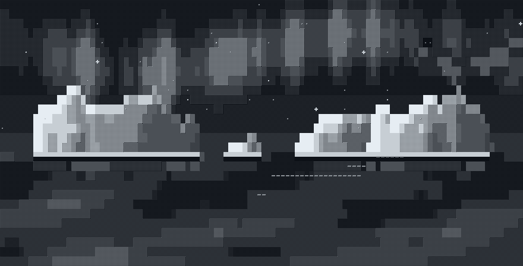
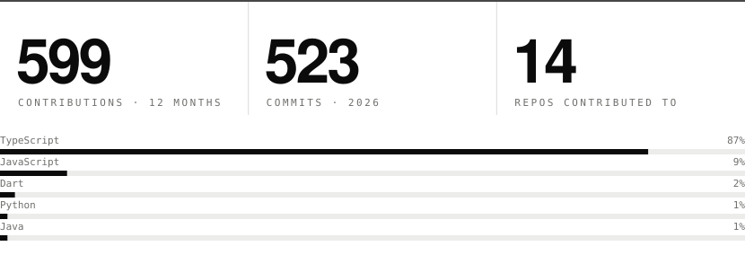

  

  <code>CS Honours @ VU Amsterdam &nbsp;·&nbsp; Amsterdam, NL &nbsp;·&nbsp; full stack &nbsp;·&nbsp; backend &nbsp;·&nbsp; LLM pipelines</code>

 

  <picture>
    <source media="(prefers-color-scheme: dark)" srcset="assets/ticker-dark.svg" />
    
  </picture>

 

  <picture>
    <source media="(prefers-color-scheme: dark)" srcset="assets/stats-dark.svg" />
    
  </picture>

  <picture>
    <source media="(prefers-color-scheme: dark)" srcset="https://github-readme-stats.vercel.app/api?username=gemesquita&show_icons=true&count_private=true&bg_color=00000000&title_color=e6edf3&text_color=8b949e&icon_color=e6edf3&border_color=30363d" />
    
  </picture>
  <picture>
    <source media="(prefers-color-scheme: dark)" srcset="https://streak-stats.demolab.com?user=gemesquita&background=00000000&border=30363d&stroke=30363d&ring=e6edf3&fire=e6edf3&currStreakNum=e6edf3&sideNums=e6edf3&currStreakLabel=8b949e&sideLabels=8b949e&dates=8b949e" />
    
  </picture>

 

  <a href="https://github.com/gemesquita/spring_hackathon_the_coding_giraffes">
    <picture>
      <source media="(prefers-color-scheme: dark)" srcset="https://github-readme-stats.vercel.app/api/pin/?username=gemesquita&repo=spring_hackathon_the_coding_giraffes&bg_color=00000000&title_color=e6edf3&text_color=8b949e&icon_color=e6edf3&border_color=30363d" />
      
    </picture>
  </a>
  <a href="https://github.com/gemesquita/gemesquita">
    <picture>
      <source media="(prefers-color-scheme: dark)" srcset="https://github-readme-stats.vercel.app/api/pin/?username=gemesquita&repo=gemesquita&bg_color=00000000&title_color=e6edf3&text_color=8b949e&icon_color=e6edf3&border_color=30363d" />
      
    </picture>
  </a>

<picture>
  <source media="(prefers-color-scheme: dark)" srcset="https://raw.githubusercontent.com/gemesquita/gemesquita/output/github-snake-dark.svg" />
  <source media="(prefers-color-scheme: light)" srcset="https://raw.githubusercontent.com/gemesquita/gemesquita/output/github-snake.svg" />
  
</picture>

 

  <a href="https://linkedin.com/in/gonçalomesquita"><picture><source media="(prefers-color-scheme: dark)" srcset="https://img.shields.io/badge/LinkedIn-21262d?style=flat-square" /></picture></a>
  <a href="mailto:gemisquita@gmail.com"><picture><source media="(prefers-color-scheme: dark)" srcset="https://img.shields.io/badge/Email-21262d?style=flat-square&logo=gmail&logoColor=white" /></picture></a>
  <a href="https://instagram.com/gm.mesquitaa"><picture><source media="(prefers-color-scheme: dark)" srcset="https://img.shields.io/badge/Instagram-21262d?style=flat-square&logo=instagram&logoColor=white" /></picture></a>

