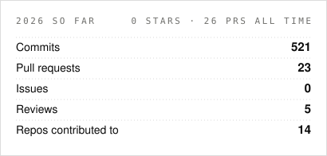
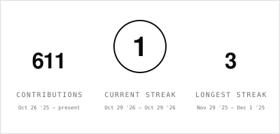
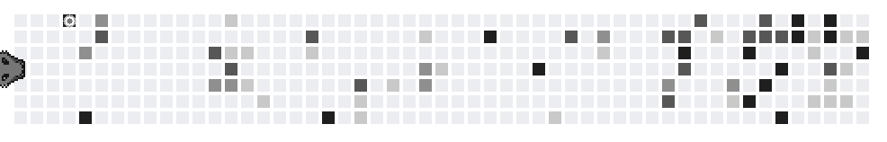
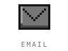

  

  <picture>
    <source media="(prefers-color-scheme: dark)" srcset="assets/tagline-dark.svg" />
    
  </picture>

 

  <picture>
    <source media="(prefers-color-scheme: dark)" srcset="assets/ticker-dark.svg" />
    
  </picture>

 

  <picture>
    <source media="(prefers-color-scheme: dark)" srcset="assets/stats-dark.svg" />
    
  </picture>

  <picture>
    <source media="(prefers-color-scheme: dark)" srcset="assets/card-stats-dark.svg" />
    
  </picture>
  <picture>
    <source media="(prefers-color-scheme: dark)" srcset="assets/card-streak-dark.svg" />
    
  </picture>

 

  <a href="https://github.com/gemesquita/spring_hackathon_the_coding_giraffes">
    <picture>
      <source media="(prefers-color-scheme: dark)" srcset="https://github-readme-stats.vercel.app/api/pin/?username=gemesquita&repo=spring_hackathon_the_coding_giraffes&bg_color=00000000&title_color=e6edf3&text_color=8b949e&icon_color=e6edf3&border_color=30363d" />
      
    </picture>
  </a>
  <a href="https://github.com/gemesquita/gemesquita">
    <picture>
      <source media="(prefers-color-scheme: dark)" srcset="https://github-readme-stats.vercel.app/api/pin/?username=gemesquita&repo=gemesquita&bg_color=00000000&title_color=e6edf3&text_color=8b949e&icon_color=e6edf3&border_color=30363d" />
      
    </picture>
  </a>

  <picture>
    <source media="(prefers-color-scheme: dark)" srcset="assets/dragon-dark.gif" />
    
  </picture>

 

  <a href="https://linkedin.com/in/gonçalomesquita"><picture><source media="(prefers-color-scheme: dark)" srcset="assets/contact-linkedin-dark.svg" /></picture></a>
  <a href="mailto:gemisquita@gmail.com"><picture><source media="(prefers-color-scheme: dark)" srcset="assets/contact-email-dark.svg" /></picture></a>
  <a href="https://instagram.com/gm.mesquitaa"><picture><source media="(prefers-color-scheme: dark)" srcset="assets/contact-instagram-dark.svg" /></picture></a>

